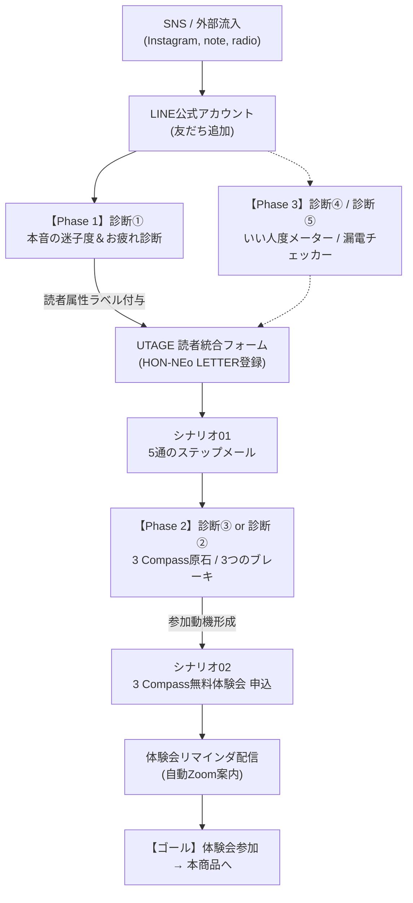

# HON-NEo（ホンネヲ）：診断ツール群 機能・システム連携仕様書

> **文書管理情報**  
> - **対象システム**: HON-NEo 診断ツール群（全5種）  
> - **連携基盤**: UTAGE（メール・LINE配信 / ファネル / シナリオ） ＋ LINE公式アカウント  
> - **作成日**: 2026年10月21日  
> - **ステータス**: 初版完成（プロトタイプ準拠）

---

## 1. システム概要・プロジェクト目的

### 1.1 目的
読者が「他人の期待」や「役割の鎧」によって見失っている**自らの本音や心の現在地を客観的に自覚化**させ、LINE登録後の離脱を防ぐとともに、UTAGEの読者統合機能を用いてメールマガジン（HON-NEo LETTER）および本命企画「**3 Compass無料体験会**」への自然な参加動機を形成する。

### 1.2 全体アーキテクチャ・導線フロー

---

## 2. システム連携・データ統合仕様（UTAGE）

### 2.1 読者データの統合（二重登録防止）
- **設定箇所**: UTAGE `メール・LINE配信` → `HON-NEo` → `シナリオ設定`（シナリオ01｜HON-NEo 一般）
- **必須設定**: **「LINE友だち追加後フォーム経由のメール情報の統合」＝『利用する』**
- **挙動**: LINE上で診断を実施後、結果画面の「処方箋レターを受け取る」からメールアドレスを入力した際、新規読者を作らず**同一読者としてLINEとメールのアカウントを紐付け結合**する。

### 2.2 付与ラベル一覧（UTAGEラベルマスター）

| 診断カテゴリ | 付与ラベル名 | トリガー条件 | 活用目的 |
| :--- | :--- | :--- | :--- |
| **診断①（迷子度）** | `診断済_迷子度` | 診断①完了時 | 診断完了者の一斉把握 |
| | `迷子_優等生の鎧` | 優等生タイプ判定 | ステップメールでの個別処方箋配信 |
| | `迷子_感情フリーズ` | フリーズタイプ判定 | 同上 |
| | `迷子_他人軸アンテナ` | アンテナタイプ判定 | 同上 |
| | `迷子_マグマ抱え込み` | マグマタイプ判定 | 同上 |
| **診断②（ブレーキ）**| `ブレーキ_完璧主義` | 完璧主義ブレーキ判定 | 体験会案内での訴求軸カスタマイズ |
| | `ブレーキ_愛され調和`| 調和ブレーキ判定 | 同上 |
| | `ブレーキ_自己犠牲` | 自己犠牲ブレーキ判定 | 同上 |
| **診断③（原石）** | `コンパス_感性美学` | 感性原石判定 | 体験会ワーク時の事前ヒアリング情報 |
| | `コンパス_共鳴絆` | 絆原石判定 | 同上 |
| | `コンパス_自由探求` | 探求原石判定 | 同上 |
| | `コンパス_静寂調和` | 調和原石判定 | 同上 |
| **診断④（いい人度）**| `ホンネ度_低` / `ホンネ度_高` | スコア判定 | SNSシェア・属性分析 |
| **診断⑤（漏電）** | `漏電_脳疲労` / `漏電_感情` / `漏電_決断` | 漏電要因判定 | 定期メルマガ（木曜配信）の配信切り分け |

---

## 3. 全5種 診断ツールの詳細機能仕様

---

### 【診断①】本音の迷子度＆お疲れタイプ診断
- **配置場所**: LINE友だち追加直後あいさつメッセージ / リッチメニュー
- **所要時間**: 約30秒（全4問）
- **判定方式**: 4タイプ最多得点方式（同点の場合はQ1の回答優先）

#### 設問定義
| 設問番号 | 質問文 | 選択肢 | 割り当てタイプ |
| :--- | :--- | :--- | :--- |
| **Q1** | 今、一番無条件に欲しいものは何ですか？ | ① 誰にも邪魔されない、1人きりの自由な時間 | 他人軸アンテナ (`antenna`) |
| | | ② 「もう頑張らなくていいよ」という許可と休息 | 優等生の鎧 (`armor`) |
| | | ③ これからの人生を迷わず選べる「明確な正解」 | 感情フリーズ (`freeze`) |
| | | ④ 溜め込んだモヤモヤや愚痴を全部吐き出せる場所 | マグマ抱え込み (`magma`) |
| **Q2** | 気乗りしない頼まれごとをされたときの最初の反応は？ | ① 断れずに笑顔で引き受け、後で一人ため息をつく | 優等生の鎧 (`armor`) |
| | | ② 相手の機嫌や関係性が壊れるのが怖くて断れない | 他人軸アンテナ (`antenna`) |
| | | ③ 嫌なのかどうかもよく分からず、機械的に受けてしまう | 感情フリーズ (`freeze`) |
| | | ④ 表面は受けつつ、内心「なんで私ばっかり…」とイラつく | マグマ抱え込み (`magma`) |
| **Q3** | 最近、一番深いため息が出たのはどんな瞬間でしたか？ | ① 周りに気を遣いすぎて、帰宅した瞬間にドッと疲れたとき | 他人軸アンテナ (`antenna`) |
| | | ② 期待に応えようと頑張ったのに、当たり前のように扱われたとき | 優等生の鎧 (`armor`) |
| | | ③ 「私、何のために毎日働いてるんだっけ？」と虚しくなったとき | 感情フリーズ (`freeze`) |
| | | ④ 言いたい正論や本音を喉元でグッと飲み込んだとき | マグマ抱え込み (`magma`) |
| **Q4** | 「あなたの本音は何？」と聞かれたら、どう感じますか？ | ① 「本音を言ったらワガママと思われるかも…」と口ごもる | 他人軸アンテナ (`antenna`) |
| | | ② 「誰かの役に立てているならそれでいい」と答えてしまう | 優等生の鎧 (`armor`) |
| | | ③ 正直、自分でも何が本音なのか本当にわからない | 感情フリーズ (`freeze`) |
| | | ④ 溢れ出したら止まらない気がして、あえて蓋をしている | マグマ抱え込み (`magma`) |

#### 判定結果と処方箋
1. **優等生の鎧タイプ（armor）**：期待に応えすぎて限界。処方箋＝努力ではなく「脱力」。1日5分、誰の期待にも応えない時間を確保。
2. **感情フリーズタイプ（freeze）**：我慢の麻痺でセンサー休眠中。処方箋＝正解探しをやめ、直感でランチや珈琲を選ぶリハビリ。
3. **他人軸アンテナタイプ（antenna）**：周囲の空気を拾いすぎて電波混線。処方箋＝他人の機嫌アンテナを畳み、自分の本音を殴り書き。
4. **マグマ抱え込みタイプ（magma）**：飲み込んだ本音が蓄積中。処方箋＝モヤモヤは情熱の裏返し。誰も見ない紙に本音をぶちまける。
- **完了時アクション**: UTAGEメール登録フォームへ自動遷移（パラメータ `?type=◯◯` 付与）。

---

### 【診断②】本音を縛る「3つのブレーキ」診断
- **配置場所**: ステップメール第3通目、体験会申込ページの手前
- **所要時間**: 約20秒（全3問）
- **判定方式**: 3タイプ最多得点方式

#### 設問定義
| 設問番号 | 質問文 | 選択肢 | 割り当てタイプ |
| :--- | :--- | :--- | :--- |
| **Q1** | 人から感謝されたり褒められたとき、咄嗟に浮かぶ感情は？ | ① 「これくらい当然。もっと完璧にやらなきゃ」と自分を追い込む | 完璧主義の呪い (`perfect`) |
| | | ② 「本音をさらけ出したら、きっと失望されて人が離れていく」 | 愛され・調和の呪い (`harmony`) |
| | | ③ 「私のことはいいから、相手が喜んでくれたならそれで満足」 | 自己犠牲の呪い (`sacrifice`) |
| **Q2** | 「これを失ったら人生終わり」と感じる最も強い恐れは？ | ① 「能力がない」「ちゃんとしていない」と思われること | 完璧主義の呪い (`perfect`) |
| | | ② 周囲から嫌われ、居場所や味方がいなくなること | 愛され・調和の呪い (`harmony`) |
| | | ③ 「自分のことばかり考えて冷たい人だ」と非難されること | 自己犠牲の呪い (`sacrifice`) |
| **Q3** | 本当は言いたい本音をグッと飲み込む一番の理由は？ | ① 100%筋の通った完璧な提案がまだできていないから | 完璧主義の呪い (`perfect`) |
| | | ② 場の空気や調和を乱してギクシャクするのが怖いから | 愛され・調和の呪い (`harmony`) |
| | | ③ 私が少し我慢すれば、みんなが丸く収まるから | 自己犠牲の呪い (`sacrifice`) |

#### 判定結果と体験会誘導
- **完璧主義の呪い**: 「70点でOKを出す勇気。世間の正解から自分の基準へシフトする3 Compass体験会へ」
- **愛され・調和の呪い**: 「本音を言っても壊れない本物の絆を見つける3 Compass体験会へ」
- **自己犠牲の呪い**: 「まず自分のコップを満たす生き方へシフトする3 Compass体験会へ」
- **完了時アクション**: シナリオ02（3 Compass無料体験会）申込ページへ遷移。

---

### 【診断③】3 Compass（選択軸）原石タイプ診断
- **配置場所**: ステップメール第5通目（最終回）、ラジオ配信リンク
- **所要時間**: 約20秒（全3問）
- **判定方式**: 4タイプ判定

#### 設問定義
| 設問番号 | 質問文 | 選択肢 | 割り当てタイプ |
| :--- | :--- | :--- | :--- |
| **Q1** | 子どもの頃、時間を忘れて夢中になっていたのはどんなこと？ | ① 絵を描く、本を読む、空想するなど自分の世界に浸る | 感性・美学 (`aesthetic`) |
| | | ② 友達とおしゃべりしたり、誰かと秘密を共有すること | 共鳴・絆 (`resonance`) |
| | | ③ 知らない路地を探検したり、新しいルールを発明すること | 自由・探求 (`freedom`) |
| | | ④ 散歩をしたり、日向ぼっこをしたり、穏やかに過ごすこと | 静寂・調和 (`harmony`) |
| **Q2** | 人から言われて、一番心の奥がジーンと満たされる言葉は？ | ① 「あなたの世界観や感性、本当に独特で素敵だね」 | 感性・美学 (`aesthetic`) |
| | | ② 「あなたに話すと、心の荷物が降りてホッとするよ」 | 共鳴・絆 (`resonance`) |
| | | ③ 「いつも自由に軽やかに、自分らしい道を切り開いてるね」 | 自由・探求 (`freedom`) |
| | | ④ 「あなたと一緒にいると、なぜか安心していられるよ」 | 静寂・調和 (`harmony`) |
| **Q3** | もし人生で「絶対に譲れないもの」を1つだけ選ぶなら？ | ① 自分の美学・妥協しないこだわり | 感性・美学 (`aesthetic`) |
| | | ② 心から深く通じ合える、温度のある人間関係 | 共鳴・絆 (`resonance`) |
| | | ③ 誰にも縛られず、自分の意志で選べる自由 | 自由・探求 (`freedom`) |
| | | ④ 静けさと安心感、波風の立たない穏やかな日常 | 静寂・調和 (`harmony`) |

#### 判定結果と体験会誘導
- 4つの原石（感性・共鳴・自由・調和）を特定した上で、**「見つかったのはあなたの1つ目の軸。残り2つのコンパスを揃えて人生の羅針盤を完成させる体験会へ」** と強力にオファー。
- **完了時アクション**: 体験会日程選択フォーム（シナリオ02登録）へ遷移。

---

### 【診断④】いい人度 vs ホンネ度メーター診断
- **配置場所**: Instagramプロフィール、ストーリーズハイライト
- **所要時間**: 約30秒（日常シチュエーション全3問）
- **判定方式**: スコアリング方式（各設問 20点 / 50〜60点 / 85〜90点、平均スコア算出）

#### 判定基準とUI演出
- **ホンネ度20%（いい人度80%）**: `平均スコア < 40点` → 「心のブレーカー寸前タイプ」
- **ホンネ度55%（いい人度45%）**: `40点 <= 平均スコア < 75点` → 「モヤモヤ燻製タイプ」
- **ホンネ度85%（いい人度15%）**: `75点 <= 平均スコア` → 「自分軸チャレンジャー」
- **UI演出**: 画面上にデュアルグラデーションゲージバー（ホンネ度／いい人度）を動的にアニメーション描画。
- **完了時アクション**: 結果シェアボタン（画像DLまたはストーリーズシェア）＋ LINE登録特典フォームへ誘導。

---

### 【診断⑤】心のエネルギー漏電チェッカー
- **配置場所**: 木曜メルマガ（HON-NEo LETTER）、月曜LINE「今週の本音の問い」
- **所要時間**: 約20秒（全3問）
- **判定方式**: 漏電原因3タイプ判定 ＋ バッテリー残量メーター表示

#### 判定結果
- **脳疲労漏電（残量25%）**: 情報・タスク過多。処方箋＝スマホデトックスと頭の棚卸し。
- **共感漏電（残量20%）**: 他人の感情受け取りすぎ。処方箋＝他人の課題との線引き、塩風呂。
- **保留漏電（残量15%）**: 決断の先送り。処方箋＝判断基準（3 Compass）の確立。
- **UI演出**: バッテリー型残量バー（赤色警告アニメーション）を表示。
- **完了時アクション**: HON-NEo LETTER特設コラムへのリンク。

---

## 4. UI/UX・デザイン仕様

### 4.1 ブランドデザイン基準
- **メインカラー**: `#2d5a43`（深みのあるフォレストグリーン：安心・本音）
- **アクセントカラー**: `#d4a373`（ゴールドアンバー：コンパス・輝き）
- **背景ベース**: `#f7f5f0`（生成り・オフホワイト：温かみ・余白）
- **文字カラー**: `#2c302e`（ソフトブラック：可読性の担保）

### 4.2 レスポンシブ＆操作性
- 最大表示幅: `440px`（スマートフォン画面に完全最適化）
- タップターゲット: 各選択肢カードは最小高さ `52px` 以上を確保
- 回答遷移: 選択肢タップで自動進行（「次へ」ボタンを押す手間を排除）
- 演出: 設問終了後、約 `850ms` の「解析中スピナー」を挟み、結果の納得感を向上

---

## 5. テスト・運用保守仕様

### 5.1 事前検証チェックリスト
- [ ] スマートフォン実機でタップ時に横スクロール崩れが発生しないか
- [ ] 診断完了時にUTAGEへ正しくラベルが送信されるか
- [ ] LINE友だち追加後のメールフォーム送信で、読者データが1つに統合されるか（二重登録確認）
- [ ] 体験会申込時にシナリオ02へ正しく遷移し、リマインダ設定が起動するか

### 5.2 KPI計測指標
- **診断開始率**: 友だち追加者のうち診断を開始した割合（目標: **60%以上**）
- **回答完了率**: Q1回答者のうち結果画面まで到達した割合（目標: **80%以上**）
- **メール登録転換率（CVR）**: 診断完了者のうちメルマガ登録に至った割合（目標: **50%以上**）
- **体験会申込転換率**: 診断③完了者のうち体験会を予約した割合（目標: **20%以上**）
