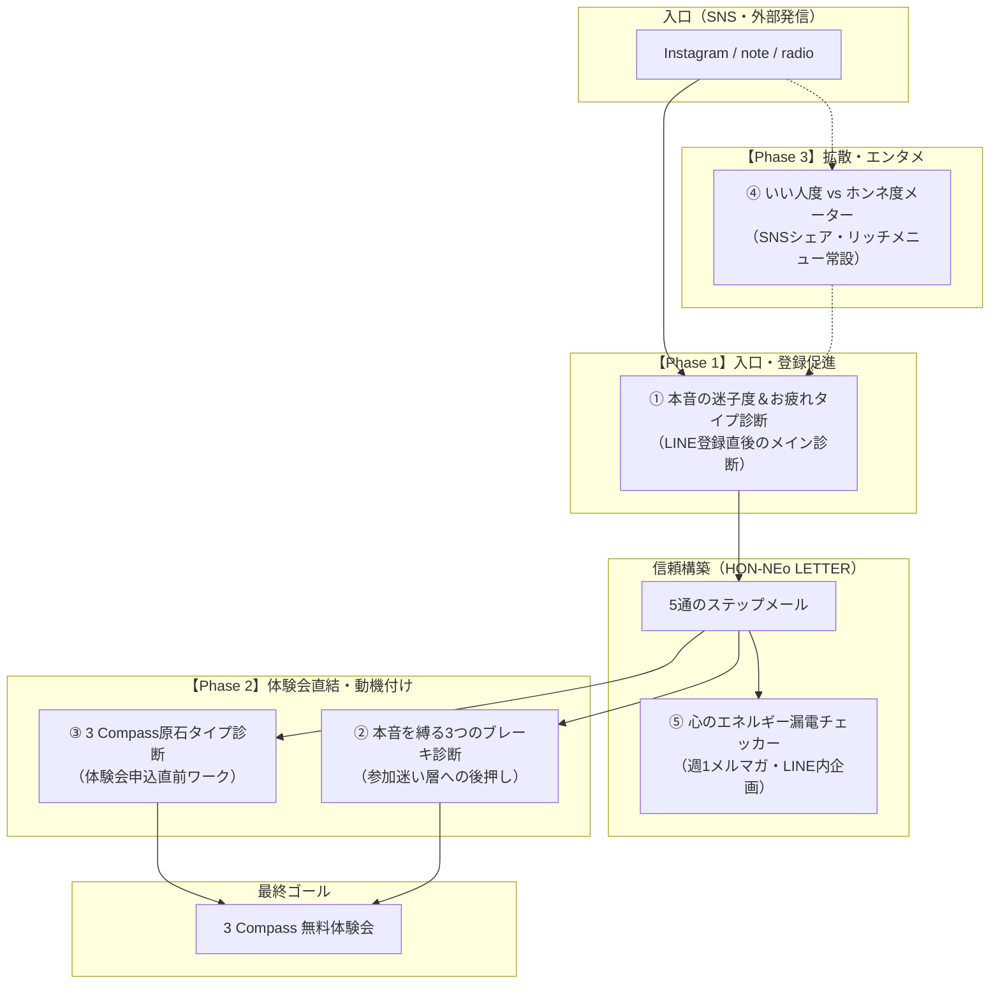

# HON-NEo（ホンネヲ）：診断ツール群 実装計画書

> **基本方針**  
> 『HON-NEo手順書』に則り、最初からすべてを同時に作って設定を複雑化させるのではなく、**「Instagram → LINE → LETTER（メール） → 3 Compass体験会」という1本の導線に沿って段階的にリリース** します。  
> 全5つの診断ツールについて、実装難易度・導線上の役割・UTAGEおよびLINEでの具体的な実装仕様とスケジュールを定義します。

---

## 1. 診断ツール全体の役割分担と導線マップ

---

## 2. フェーズ別リリース計画（ロードマップ）

| フェーズ | 実装対象 | 主な目的 | 推奨ツール/場所 | 想定期間 |
| :--- | :--- | :--- | :--- | :--- |
| **Phase 1** （即時着手） | **① 本音の迷子度＆お疲れタイプ診断** | LINE友だち登録の導線確立、読者情報の統合、初期エンゲージメント獲得 | LINE自動応答 / リッチメニュー | 1〜2週目 |
| **Phase 2** （導線接続） | **③ 3 Compass原石タイプ診断** ＋ **② 3つのブレーキ診断** | 体験会の参加意欲向上、ステップメール4〜5通目からの体験会申込率最大化 | UTAGEアンケートフォーム（Webページ） | 3〜4週目 |
| **Phase 3** （拡散・定着） | **④ いい人度メーター診断** ＋ **⑤ 心のエネルギー漏電チェッカー** | SNS（Instagramストーリーズ等）での新規流入拡散、日常配信での関係深化 | LINEリッチメニュー / Web診断LP | 5週目〜 |

---

## 3. 各診断ツールの実装仕様書

### 【Phase 1】ツール①：『本音の迷子度＆お疲れタイプ診断』
* **配置場所**: LINE公式アカウントの友だち追加時あいさつメッセージ ＋ リッチメニュー
* **実装方式**: UTAGEの「LINEメッセージ配信（カルーセルまたは画像タップ）」＋「フォーム/アンケート」
* **設問設計**: 全4問（3択・タップ式でサクサク進む設計）
  - Q1: 「今、一番欲しいものは？」
  - Q2: 「人から頼まれごとをされたときの最初の反応は？」
  - Q3: 「最近、一番深いため息が出たのは？」
  - Q4: 「自分の本音を言おうとしたときの感覚は？」
* **診断タイプ**:
  1. `優等生の鎧` タイプ
  2. `感情フリーズ` タイプ
  3. `他人軸アンテナ` タイプ
  4. `マグマ抱え込み` タイプ
* **UTAGE自動アクション**:
  - ラベル付与: `迷子度診断済`、各タイプ別ラベル（例: `タイプ_優等生`）
  - メール登録フォームへの誘導（「あなたのタイプ別解説レターを受け取る」）
  - 読者統合設定: LINE友だち追加後フォーム経由でメール情報を1人の読者に統合

---

### 【Phase 2】ツール③：『3 Compass（選択軸）原石タイプ診断』
* **配置場所**: HON-NEo LETTER（ステップメール第5通目） ＋ 体験会募集ページ直前
* **実装方式**: UTAGEのファネル機能（アンケートページ／診断LP）
* **設問設計**: 全5問（未来の選択軸・価値観を炙り出す設問）
  - Q1: 「子どもの頃、時間を忘れて熱中していた時の感情は？」
  - Q2: 「人生で『最高の瞬間だった』と感じるのはどんな場面？」
  - Q3: 「無人島に1つだけ持っていくなら？」
  - Q4: 「他人に言われて一番嬉しかった言葉は？」
  - Q5: 「これから一番大切にしたい時間の使い方は？」
* **診断タイプ**:
  1. `感性・美学コンパス`
  2. `共鳴・絆コンパス`
  3. `自由・探求コンパス`
  4. `静寂・調和コンパス`
* **体験会への接続導線**:
  - 結果ページ末尾：「あなたの1つ目のコンパスは【◯◯】です。ただし、人生をブレずに進めるには残り2つのコンパスを組み合わせる必要があります。体験会であなたの3つの軸を完成させましょう」
  - ワンクリックで「3 Compass無料体験会」申込フォーム（シナリオ02）へ遷移。

---

### 【Phase 2】ツール②：『本音を縛る「3つのブレーキ」診断』
* **配置場所**: ステップメール再案内、体験会リマインド、個別相談前
* **実装方式**: UTAGEアンケート（スコアリング形式 または 複数選択式）
* **設問設計**: 全3問（無意識の恐怖・思い込みの特定）
  - Q1: 「『これをやったらおしまい』と感じる最大の恐怖は？」
  - Q2: 「幼少期や過去、周囲から一番強く求められた役割は？」
  - Q3: 「本音を言うのをためらう一番の理由は？」
* **診断結果**:
  - `ブレーキ①：完璧主義の呪い`
  - `ブレーキ②：愛され・調和の呪い`
  - `ブレーキ③：自己犠牲の呪い`
* **体験会への接続導線**:
  - 「ブレーキを外すための最初の一歩」として3 Compass体験会の事例を提示。

---

### 【Phase 3】ツール④：『いい人度 vs ホンネ度メーター診断』
* **配置場所**: Instagramプロフィールリンク、ストーリーズハイライト、LINEリッチメニュー
* **実装方式**: 軽量Web診断ページ（HTML/JS または UTAGEファネル）
* **設問設計**: 日常あるあるシチュエーション 3問（二者択一または3択）
* **診断結果**:
  - `ホンネ度20%`（いい人度80%：心のブレーカー寸前）
  - `ホンネ度50%`（モヤモヤ燻製タイプ）
  - `ホンネ度80%`（本音で生きるチャレンジャー）
* **活用法**:
  - 「結果をスクショしてInstagramストーリーズでシェア」を促す。
  - LINE登録特典として「いい人のまま本音を伝える処方箋」をプレゼント。

---

### 【Phase 3】ツール⑤：『心のエネルギー漏電チェッカー』
* **配置場所**: 木曜の定期メルマガ（HON-NEo LETTER）、月曜のLINE「今週の本音の問い」
* **実装方式**: 1問〜2問のクイックアンケート（LINE内クリック）
* **活用法**:
  - 読者の現在の疲弊ポイント（人間関係／仕事／家庭）を定期収集。
  - 回答に応じたメルマガ・ラジオのテーマ選定にフィードバック。

---

## 4. 制作アセット・タスク一覧（WBS）

### 1. コピーライティング（テキスト制作）
- [ ] **診断①（迷子度）**: 設問文（4問）、選択肢、結果解説文（4タイプ×各400字）
- [ ] **診断①後のメール誘導文**: LINE配信テキスト、フォーム登録完了メール
- [ ] **診断③（3 Compass原石）**: 設問文（5問）、各タイプ解説文、体験会案内誘導コピー
- [ ] **診断②（ブレーキ）**: 設問文（3問）、ブレーキ解除のヒント文

### 2. デザイン・クリエイティブ制作
- [ ] **LINEリッチメニュー画像**: 診断開始ボタンの配置（大サイズ 2500×1686px）
- [ ] **診断アイキャッチ画像**: Instagramストーリーズ用・LINE送信用バナー
- [ ] **タイプ別結果カード画像**: 4タイプ分のグラフィック（シェア用）

### 3. UTAGE・LINEシステム構築
- [ ] UTAGE配信アカウント「HON-NEo」内にアンケート/診断ファネル作成
- [ ] ラベル自動付与ルールの設定（診断完了、タイプ別）
- [ ] シナリオ01（一般）への読者情報統合テスト
- [ ] 診断結果からシナリオ02（体験会）への遷移リンク設定

---

## 5. テスト・検証およびKPI指標

### 主要KPI
1. **診断回答完了率**: 診断開始者のうち最後まで回答した割合（目標: **70%以上**）
2. **メール登録転換率**: 診断完了者のうち「HON-NEo LETTER」に登録した割合（目標: **50%以上**）
3. **体験会申込率**: 診断③回答者のうち体験会に申し込んだ割合（目標: **15〜20%**）

### セルフテスト手順（本番公開前チェック）
1. スマホの実機でInstagram想定リンクからLINE登録を行う。
2. 友だち追加後、診断①がスムーズに開始・回答できるか確認。
3. 診断完了後、正しいラベルが付与されているかUTAGE管理画面で確認。
4. LINE友だち情報とメールアドレスが1つの読者データとして二重登録なく統合されているか確認。
5. 診断③から体験会（シナリオ02）へ正しく遷移し、リマインダ設定が作動するかテスト。
