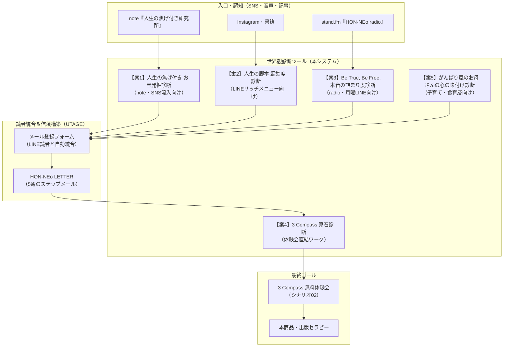

# 矢野尚美の世界観を宿す「HON-NEo 診断ツール群」完全システム仕様書

> **文書管理情報**  
> - **対象システム**: 矢野尚美 世界観反映 診断ツール群（全5案）  
> - **格納ディレクトリ**: `矢野尚美_世界観診断ツール/`  
> - **連携プラットフォーム**: UTAGE（メール・LINE配信 / シナリオ / ファネル） ＋ LINE公式アカウント  
> - **作成日**: 2026年10月21日  
> - **ステータス**: プロトタイプ完成・本番実装対応版

---

## 1. プロジェクト背景とブランド理念

### 1.1 ブランドコア（矢野尚美のメッセージ）
- **合言葉**: 『Be True , Be Free. 本音で自由に生きよう！』
- **理念**: 「人生は何度でも編集できる」「他人の書いた台本ではなく、自分の本音から人生を選ぶ」
- **核心の比喩**: 元パティシエ・調理師としての経験から生まれた**「人生の焦げ付き」**（挫折、後悔、黒歴史こそが熟成された極上のキャラメル・旨みになる）
- **コアメソッド**:
  - **出版セラピー**: 思考と感情を仕組み化し、自分の言葉で人生を再構成する
  - **3 Compass（3つの選択軸）**: 他人の期待や世間の正解に振り回されない、自分だけの人生の羅針盤

### 1.2 導線アーキテクチャ（全体像）

---

## 2. UTAGEシステム連携・ラベル設計

### 2.1 読者統合設定（二重登録防止）
- **設定箇所**: UTAGE `メール・LINE配信` → `HON-NEo` → `シナリオ設定`（シナリオ01）
- **設定値**: **「LINE友だち追加後フォーム経由のメール情報の統合」＝『利用する』**
- **動作**: 診断結果画面のボタンからメールアドレスを登録した際、LINEアカウントと同一人物として統合。

### 2.2 付与ラベルマスター

| 診断分類 | ラベル名 | トリガー | 活用目的 |
| :--- | :--- | :--- | :--- |
| **【案1】焦げ付き** | `焦げ_焦がしバター` | バター判定 | 自己犠牲を緩めるステップメール配信 |
| | `焦げ_香ばしナッツ` | ナッツ判定 | 人間関係の境界線を整えるレター配信 |
| | `焦げ_ビターキャラメル` | キャラメル判定 | 「ちゃんとしなきゃ」を脱ぐ処方箋配信 |
| | `焦げ_幻のスパイス` | スパイス判定 | 人生逆転ストーリーの配信 |
| **【案2】脚本編集** | `脚本_他人軸20` | スコア < 40点 | ゴーストライター脱却ワーク案内 |
| | `脚本_葛藤50` | 40点 <= スコア < 75点 | 下書き推敲サポート案内 |
| | `脚本_自分軸85` | 75点 <= スコア | 自分の物語を届ける発信案内 |
| **【案3】詰まり度** | `詰まり_喉元ロック` | 喉判定 | 言葉にするための「ひとり言ノート」案内 |
| | `詰まり_思考グルグル`| 頭判定 | 快・不快を優先する感覚リハビリ案内 |
| | `詰まり_足踏みフリーズ`| 足判定 | 3秒でできる小さな本音アクション案内 |
| **【案4】3 Compass** | `コンパス_感性美学` | 感性判定 | 体験会ワーク時の事前カルテ |
| | `コンパス_共鳴絆` | 絆判定 | 同上 |
| | `コンパス_自由探求` | 探求判定 | 同上 |
| | `コンパス_静寂調和` | 調和判定 | 同上 |
| **【案5】心の味付け** | `味付け_だし殻` | だし殻判定 | 罪悪感を手放す食育・セルフケア案内 |
| | `味付け_佃煮` | 佃煮判定 | 煮詰まりをほどく余白づくり案内 |
| | `味付け_激辛` | 激辛判定 | 休息・脱力アプローチ案内 |

---

## 3. 全5案 詳細機能・設問仕様

---

### 【案1】人生の焦げ付き お宝発掘診断
- **目的**: 挫折や失敗を「名作の旨み・キャラメル」として肯定し、自己受容から本音を導く。
- **設問数**: 全4問（選択式）
- **判定方式**: 最多得点方式

#### 設問と選択肢
1. **Q1: 人生で一番「あぁ、やっちゃったな…（焦げ付いた）」と感じる時期や出来事は？**
   - ① 誰かの期待に応えようと頑張りすぎて、心や体を壊して立ち止まったこと (`butter`)
   - ② 家族やパートナー、人間関係の衝突・すれ違いで、深く傷つき悩んだこと (`nuts`)
   - ③ 周りの目を気にして「いい人」を続け、自分の本音を何年も飲み込み続けたこと (`caramel`)
   - ④ 「私の人生、こんなはずじゃなかった」と、遠回りばかりで何も残っていないように思えること (`spice`)
2. **Q2: 気の置けない友人と話しているとき、ふと漏れる本音はどれに近い？**
   - ① 「いつも周りの段取りやフォローばかりで、自分のことが一番後回しになっちゃう」 (`butter`)
   - ② 「言いたいことを我慢するか、爆発して自己嫌悪になるかの二者択一になっちゃう」 (`nuts`)
   - ③ 「『ちゃんとしなきゃ』が口癖で、息の抜き方が正直わからないんだよね」 (`caramel`)
   - ④ 「本当はもっとやりたいことがある気がするのに、何から手をつけていいか迷子」 (`spice`)
3. **Q3: お鍋が焦げ付いたとき（トラブルや壁にぶつかったとき）、あなたの最初の反応は？**
   - ① 「私がもっとしっかりしていれば…」と自分を責めて、一人で必死に焦げをこすり落とそうとする (`butter`)
   - ② 「なんで分かってくれないの！」と理不尽さにモヤモヤし、感情がグルグル渦巻く (`nuts`)
   - ③ 見なかったことにしてフタをし、「大丈夫、何でもない」と笑顔を取り繕う (`caramel`)
   - ④ 「もう全部嫌だ、鍋ごと捨ててリセットしたい」と立ち尽くしてしまう (`spice`)
4. **Q4: もし、これからの人生で「1つだけ魔法が使える」としたら、何が欲しい？**
   - ① 「誰の期待にも応えなくていい、完全な余白と自由な時間」 (`butter`)
   - ② 「本音をぶつけ合っても絶対に壊れない、心底安心できる絆」 (`nuts`)
   - ③ 「『これが私です』と胸を張って言える、ブレない自分の芯（選択軸）」 (`caramel`)
   - ④ 「自分のこれまでの経験すべてが『これで良かったんだ』と思える納得感」 (`spice`)

#### 結果パターン
- **【焦がしバター】タイプ**: 周りを引き立てる名脇役を卒業し、自分が主役になる番。
- **【香ばしナッツ】タイプ**: 衝突や痛みを乗り越えた強さ。誰かの背中を押すリーダー。
- **【ほろ苦ビターキャラメル】タイプ**: 我慢と忍耐の熟成度No.1。深い共感で人を癒やす語り手。
- **【幻のスパイス】タイプ**: 遠回りこそが唯一無二の物語。人生を大逆転させる変革者。

---

### 【案2】40代からの『人生の脚本（シナリオ）編集度診断』
- **目的**: 他人の書いた台本を生きている度合いを可視化し、自分の物語をリライトする動機をつくる。
- **設問数**: 全3問
- **判定方式**: スコアリング方式（各問 20点 / 50点 / 90点、平均スコア）

#### 設問と選択肢
1. **Q1: 日常で「何かを決める」とき、あなたの頭に最初に浮かぶのは？**
   - ① 家族や周囲が困らないか、常識から外れていないか（20点）
   - ② 本当はこうしたいけど、角が立たない妥協点はどこか（50点）
   - ③ 私の心はワクワクしているか、納得しているか（90点）
2. **Q2: これまでの人生を振り返ったとき、一番近い感覚は？**
   - ① 誰かが敷いたレールの上を、脱線しないように必死に走ってきた（20点）
   - ② 一生懸命生きてきたけれど、なんだか他人の人生の脇役を演じている気がする（50点）
   - ③ 色々あったけれど、すべての選択を自分の意志で引き受けてきた（90点）
3. **Q3: 「これから先の人生、何でも自由に選んでいい」と言われたら？**
   - ① 自由と言われても、何をしたいのか本当に分からない…（20点）
   - ② やりたいことはあるけれど、家族やお金の制限で諦めている（50点）
   - ③ 自分の本音を形にして、新しい物語を書き始めたい！（90点）

#### 結果パターン
- **スコア < 40点**: 【ゴーストライター執筆中】度80%（他人の台本を忠実に演じている状態）
- **40点 <= スコア < 75点**: 【下書き推敲中】度50%（違和感に気づき、赤ペンを持ち始めた状態）
- **75点 <= スコア**: 【敏腕・自分編集長】度85%（自分の本音で物語を描き始めている状態）

---

### 【案3】『Be True, Be Free. 本音の詰まり度＆解放ルート診断』
- **目的**: stand.fm『HON-NEo radio』連動。本音が身体のどこで止まっているかを特定。
- **設問数**: 全3問
- **判定方式**: 3タイプ最多得点方式

#### 結果パターン
- **【喉元ロック】タイプ**: 優しすぎて言葉を飲み込み中 → 処方箋：1人の場所で本音を叫ぶ練習
- **【思考グルグル】タイプ**: 感情を理屈で丸め込み中 → 処方箋：身体の快・不快（直感）を信じる練習
- **【足踏みフリーズ】タイプ**: 変化が怖くて現状維持中 → 処方箋：3秒でできる小さな本音アクション

---

### 【案4】『3 Compass（選択軸）原石タイプ診断』
- **目的**: 料理や日常の感性から、人生の3つの羅針盤の「1つ目」を特定し体験会へ直結。
- **設問数**: 全3問
- **判定結果**:
  - **【感性・美学コンパス】の原石**: 妥協なき美意識で世界を切り取る人
  - **【共鳴・絆コンパス】の原石**: 深い心の通い合いが命を灯す人
  - **【自由・探求コンパス】の原石**: 枠組みを越えて未知の地平を開拓する人
  - **【静寂・調和コンパス】の原石**: 穏やかな安心感と余白を創り出す人

---

### 【案5】がんばり屋のお母さんのための『心の味付け診断』
- **目的**: 『料理しない子育て法』の読者層に向け、家族に尽くしすぎて自分を失っている心をケア。
- **設問数**: 全3問
- **結果パターン**:
  - **【だし殻（がら）】タイプ**: 家族に旨みを出し尽くしてスカスカに。自分を満たす出汁を補給しよう。
  - **【煮詰まり佃煮】タイプ**: 我慢と責任感が濃縮。お湯で割るように人生に余白を。
  - **【激辛スパイス】タイプ**: アドレナリンで走り続けて胃が悲鳴。脱力と優しい休息を。
  - **【滋味あふれるスープ】タイプ**: 本来のあなたの温かい本音を取り戻すスタート地点。

---

## 4. UI/UX・デザインガイドライン

- **カラーパレット**:
  - メインブランド色: `#28523b`（フォレストグリーン：安心と再生）
  - キャラメルゴールド: `#c88a4b`（焦がしバター・お宝・温かみ）
  - ベース背景色: `#faf7f2`（生成り紙・本の手触り）
  - テキスト主色: `#2a2b2a`（ソフトブラック：可読性の確保）
- **操作性**:
  - 全5案が画面上部のボタン・ドロップダウンで見切れずワンタップで切り替え可能
  - 1問ごとに自動進行するスムーズなアニメーション
  - 解析中スピナーによる期待感醸成
